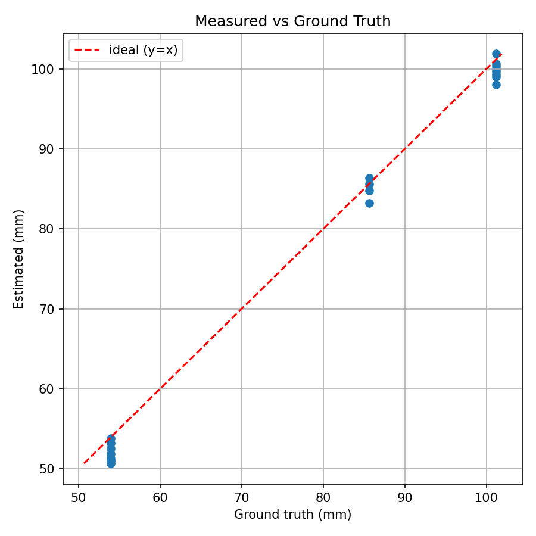

# Module 2: Object Dimension Measurement

Measure the real-world size of an object from a single smartphone photo, using
camera calibration and the pinhole camera model.

## Overview

| Part | What it does |
|---|---|
| Calibration | Recovers the camera matrix K and lens distortion from chessboard photos |
| Measurement | Converts two clicked pixels into a distance in millimetres |
| Validation | 20 measurements of a known object from more than 2 m away, with error statistics |
| Theory | Derivation of how one 3D point appears in two cameras (epipolar geometry) |

## Approach

### 1. Camera calibration

18 photos of a printed 9 x 6 chessboard (30 mm squares) taken with an iPhone.
OpenCV finds the inner corners in each photo, and `cv2.calibrateCamera` solves
for the intrinsic matrix K and the distortion coefficients.

### 2. Measurement with the pinhole model

A pixel (u, v) at depth Z maps back to camera coordinates by inverting the
projection equations. The two clicked points are undistorted first, then:

```
X = (u - cx) * Z / fx
Y = (v - cy) * Z / fy
D = sqrt((X2 - X1)^2 + (Y2 - Y1)^2)
```

### 3. Validation

The test object is a MARTA Breeze card, which follows the ID-1 standard
(85.60 x 53.98 mm), so the ground truth is exact. The card was photographed
from 4 distances between 2.11 m and 2.54 m. In each photo the card's width
gives the distance Z, and that Z is then used to measure the other four
lengths (both heights and both diagonals). That gives 20 measurements that are
independent of the length used to find Z.

## Results

| Metric | Value |
|---|---|
| Calibration images used | 18 / 18 |
| Reprojection error | **0.392 px** RMS |
| Focal length | fx = 3023.59, fy = 3028.34 px |
| Principal point | cx = 1532.54, cy = 1999.80 px |
| Validation measurements | 20, at 2.11 to 2.54 m |
| Mean absolute error (MAE) | **1.64 mm** |
| RMSE | 1.93 mm |
| Mean absolute percentage error (MAPE) | **2.37%** |



## Project structure

```
module2/
├── __init__.py              web app page (4 tabs: calibration, measure, validation, theory)
├── common.py                shared maths: calibration I/O, pinhole back-projection
├── calibrate.py             CLI: calibrate from chessboard photos
├── measure.py               CLI: measure an object in one photo
├── validate.py              CLI: run the 20-measurement validation
├── selftest.py              end-to-end test on synthetic images with a known camera
├── theory.md                two-camera derivation
├── calibration/
│   └── camera_params.npz    K and distortion coefficients
├── data/
│   ├── calibration_images/  18 chessboard photos
│   ├── measurement_images/  4 validation photos
│   └── measurements.csv     the 20 validation measurements
└── results/
    ├── calibration_corners.jpg   detected chessboard corners (home page picture)
    ├── validation_plot.png
    └── validation_results.csv
```

## Usage

Web app (from the repo root):

```
pip install -r requirements.txt
streamlit run app.py
```

Command line (from `modules/module2`):

```
# calibrate (rows/cols are inner corners)
python calibrate.py --images data/calibration_images --rows 6 --cols 9 --square 30.0

# measure the distance between two pixels at a known distance Z (mm)
# (add --image <photo> instead of --p1/--p2 to click the points yourself)
python measure.py --calib calibration/camera_params.npz --Z 2125.1 --p1 984 2014 --p2 1108 2013

# validation statistics and plot
python validate.py --calib calibration/camera_params.npz --csv data/measurements.csv --plot
```

## Theory

`theory.md` derives the relationship between a 3D point's image coordinates in
two cameras at different positions and orientations, ending with the epipolar
constraint and the fundamental matrix.

## References

- Z. Zhang, "A flexible new technique for camera calibration", IEEE TPAMI, 2000.
- R. Hartley and A. Zisserman, *Multiple View Geometry in Computer Vision*, 2nd ed., 2004.
- OpenCV documentation: camera calibration (`calibrateCamera`, `undistortPoints`).
