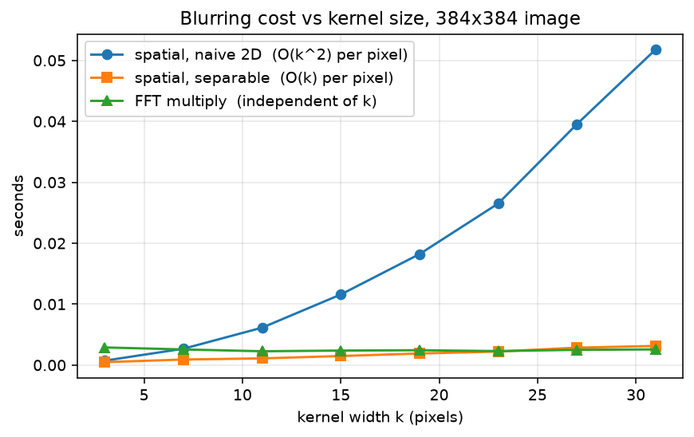

# Module 3: Image Blurring and the Convolution Theorem

Blur an image in two ways, by spatial convolution and by multiplication in the
Fourier domain, and show that both give the same image.

## Overview

| Part | What it does |
|---|---|
| Implementation | Box and Gaussian blur written from scratch as a 2D convolution |
| Fourier version | The same blur done as a product of DFTs |
| Evidence | 21 automated checks comparing the two methods, plus a speed benchmark |
| Theory | Proof of the convolution theorem (continuous and discrete) with a worked example |

## Approach

### Spatial filtering

`filtering.py` builds normalised box and Gaussian kernels (they sum to 1) and
applies them with a 2D convolution written out in NumPy. OpenCV's blur
functions are not used for the results; `cv2.filter2D` appears only inside the
self-test, as an independent reference to check against.

- Four boundary modes: `wrap`, `zero`, `reflect`, `replicate`
- The Gaussian can also run as two separable 1D passes

### Fourier filtering

- `convolve_fft_circular()`: the plain DFT product, which is circular convolution
- `convolve_fft_linear()`: zero-padded to N + k - 1, which is linear convolution

The kernel is shifted by -(k // 2) before the transform so that its centre
sits at index 0, the origin the DFT expects.

### Matching the two

The DFT treats the image as periodic, so it matches spatial convolution with
the `wrap` boundary, and the zero-padded FFT matches the `zero` boundary. With
the conventions matched, the two methods agree at every pixel. The app also
shows what happens with mismatched boundaries: the difference is confined to a
border strip exactly (k - 1) / 2 pixels wide, and the interior still agrees to
4.8e-13.

## Results

| Metric | Value |
|---|---|
| Kernels tested | box and Gaussian, 3 x 3 to 31 x 31 |
| Image size | 1160 x 1200 |
| Max difference, spatial vs Fourier | **1.1e-12** grey levels (0 to 255 scale) |
| PSNR between the two methods | above 300 dB |
| Automated checks | **21 / 21 pass** |
| Speed crossover (naive spatial vs FFT) | k = 7 on a 384 x 384 image |

The differences are at the level of double-precision round-off, so the two
methods produce the same image.

The benchmark also shows the cost trade-off: the FFT's run time stays flat as
the kernel grows, naive spatial convolution grows like k², and the separable
Gaussian stays fast up to 31 x 31.



## Sample images

| Image | Why it's included |
|---|---|
| `text_journal.jpg` | Thin handwritten strokes, so the blur is easy to see |
| `brick_wall.jpg` | A repeating pattern shows up as distinct peaks in the spectrum |
| `building_sky.jpg` | Hard edges against flat sky, good for comparing box and Gaussian |

## Project structure

```
module3/
├── __init__.py               web app page (6 tabs)
├── filtering.py              all the maths: kernels, spatial and FFT convolution, metrics
├── blur.py                   CLI: blur one image, optionally compare both methods
├── verify_convolution.py     CLI: 21 checks, equivalence table, timing benchmark
├── theory.md                 proof of the convolution theorem
├── data/module3_samples/     three sample photos
└── results/
    ├── blur_example.jpg       original vs blurred (home page picture)
    ├── results_equivalence.csv
    ├── results_timing.csv
    └── timing_plot.png
```

## Usage

Web app (from the repo root):

```
pip install -r requirements.txt
streamlit run app.py
```

Command line (from `modules/module3`):

```
# blur an image
python blur.py --image data/module3_samples/text_journal.jpg \
               --filter gaussian --sigma 3 --out blurred.png

# blur it both ways and print the difference
python blur.py --image data/module3_samples/text_journal.jpg \
               --filter gaussian --sigma 3 --compare

# run all checks and regenerate the results/ files
python verify_convolution.py --all
```

## Theory

`theory.md` proves the convolution theorem for continuous and discrete
signals, covers circular vs linear convolution, and works through an
8-sample example with the full DFT table. Tab 5 of the app recomputes the same
example live.

## References

- R. C. Gonzalez and R. E. Woods, *Digital Image Processing*, 4th ed., 2018.
- A. V. Oppenheim and R. W. Schafer, *Discrete-Time Signal Processing*, 3rd ed., 2009.
- NumPy FFT documentation (`numpy.fft`).
