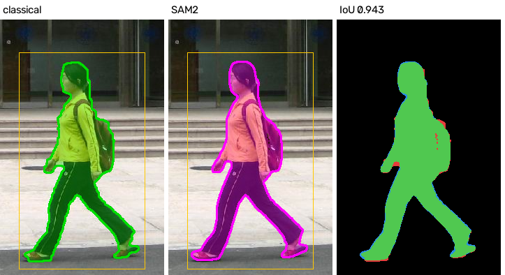
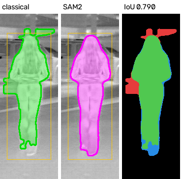

# Module 4: Human Boundary Detection (RGB and Thermal)

Find the exact outline of a person in an RGB image and in a thermal image using
classical computer vision only, and compare the results with SAM2.

## Overview

| Part | Method |
|---|---|
| Q1: RGB image | GrabCut (graph cut on colour models) |
| Q2: Thermal image | Background subtraction + hysteresis threshold |
| Comparison | IoU and Dice against SAM2 masks |
| Q3: Theory | Edge detection and region segmentation in the Fourier domain |

No deep learning or machine learning is used for the results. SAM2 is only the
reference; its masks are generated once, offline, and loaded from files.

## Approach

Both methods start from the same input SAM2 gets: a box around the person
(`data/prompts.json`). The final outline is traced with
`cv2.findContours(..., CHAIN_APPROX_NONE)`, which keeps every boundary pixel.

### Q1: RGB with GrabCut (`segment.grabcut_person`)

GrabCut fits two colour models, one for the person and one for the
background, to the pixels of this image only, then finds the best labelling
with a min-cut and repeats. Nothing is trained in advance. To start it off:

1. A thin vertical strip in the middle of the box is fixed as person.
2. Pixels whose colour mostly appears outside the box start as background.
3. GrabCut re-fits the colour models and cuts again until it settles.

### Q2: Thermal with thresholding (`segment.thermal_person`)

In a thermal image brightness tracks temperature, so a person stands out from
a cooler scene.

1. Estimate the background with a wide median filter and subtract it, which
   removes large warm areas like the road.
2. Hysteresis threshold: Otsu's level for strong pixels, and a lower level for
   pixels connected to them.
3. Morphological clean-up and hole filling.

### Q3: Theory (`theory.md`)

- The derivative theorem, and why edge detection is high-pass filtering
- Why noise turns it into band-pass filtering (derivative of Gaussian, LoG)
- High-pass filter design
- Low-pass and band-pass energy for finding regions
- A small worked example by hand

## Results

| Image | Method | IoU vs SAM2 | Dice vs SAM2 |
|---|---|---|---|
| RGB: FudanPed00013 | GrabCut | **0.943** | **0.971** |
| Thermal: FLIR_07583 | Threshold | **0.790** | **0.883** |





## Project structure

```
module4/
├── __init__.py            web app page (RGB, thermal, theory tabs)
├── segment.py             the RGB and thermal methods, IoU and Dice
├── find_person.py         CLI: outline a person in one image
├── compare.py             CLI: compare both methods with SAM2
├── sam2_reference.py      generates the SAM2 masks offline (not used by the app)
├── theory.md              Q3 derivations
├── data/
│   ├── rgb/, thermal/     input images
│   ├── sam2_masks/        SAM2 reference masks
│   ├── prompts.json       the box around the person in each image
│   └── SOURCES.md         where the images come from
└── results/
    ├── results_comparison.csv
    ├── compare_rgb.png
    ├── compare_thermal.png
    └── thermal_stages.png
```

## Usage

Web app (from the repo root):

```
pip install -r requirements.txt
streamlit run app.py
```

Command line (from `modules/module4`):

```
python find_person.py --sample FudanPed00013.png    # Q1, RGB
python find_person.py --sample FLIR_07583.png       # Q2, thermal
python compare.py                                   # comparison with SAM2, written to results/
```

`find_person.py` writes the mask, an overlay and the boundary points
(`_boundary.txt`, one x, y per line) to `out/`.

Regenerating the SAM2 masks is optional and needs PyTorch:

```
pip install ultralytics torch torchvision
python sam2_reference.py
```

## References

- C. Rother, V. Kolmogorov and A. Blake, "GrabCut: Interactive foreground extraction using iterated graph cuts", SIGGRAPH, 2004.
- N. Otsu, "A threshold selection method from gray-level histograms", IEEE SMC, 1979.
- N. Ravi et al., "SAM 2: Segment Anything in Images and Videos", 2024.
- Images: see `data/SOURCES.md`.
