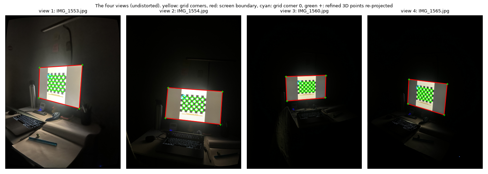

# Modules 5 & 6: Optical Flow and Structure from Motion

Dense optical flow and Lucas-Kanade tracking on two road videos, and a 3D
reconstruction of a flat object from four photos.

## Overview

| Part | What it does |
|---|---|
| A. Optical flow | Flow videos for two 30 s clips, camera motion removal, analysis of what is moving |
| A. Tracking | Lucas-Kanade tracking and bilinear interpolation implemented from first principles, checked against real pixel positions |
| B. Structure from motion | Reconstructs a notebook from 4 photos and recovers its boundary, camera positions and camera parameters |

## Part A: Optical flow and tracking

### Data

Two 30 s clips recorded hand-held on an iPhone at a road intersection,
converted from HDR to SDR at 960 x 540, 30 fps.

- **Video 1:** cars crossing in both directions, camera held still
- **Video 2:** camera held still, then panned left and right across the scene

### Approach

1. **Dense flow:** Farneback optical flow for every frame pair, colour-coded
   by direction and speed and written out as a video.
2. **Camera motion:** a homography fitted with RANSAC to corners across each
   frame gives the hand-held camera's own motion, which is subtracted so that
   only real scene motion remains.
3. **Tracking:** my own pyramidal, iterative Lucas-Kanade tracker
   (`flow.py`), derived from the brightness constancy constraint, with bilinear
   interpolation for sub-pixel sampling.
4. **Check:** on two consecutive frames, the tracker's predicted positions are
   compared with the actual positions found by correlation, and one point is
   worked through by hand (`results/workings_*.md`).

### Results: flow analysis

| | Video 1 | Video 2 |
|---|---|---|
| Camera motion | 0.10 px/frame median | 0.15 px/frame still, up to 7.4 px/frame while panning |
| Background after removing camera motion | 0.07 px/frame | 0.10 px/frame |
| Car speed in the image | 10.8 px/frame average, up to 28 | 11.3 px/frame average, up to 26 |
| Direction of traffic | 48% left, 52% right | 91% right |
| Image speed, far lane to near lane | 10 to 24 px/frame | 6 to 20 px/frame |

### Results: tracking check

| | Video 1 (frames 583 to 584) | Video 2 (frames 289 to 290) |
|---|---|---|
| Points tracked (reliable) | 38 (29) | 36 (26) |
| Median motion | 10.8 px | 21.3 px |
| Median \|predicted - actual\| | **0.08 px** | **0.09 px** |
| Reliable points within 0.5 px | 26 / 29 | 22 / 26 |
| Median difference from OpenCV's LK | 0.003 px | 0.006 px |

## Part B: Structure from motion

### Data

A spiral notebook lying flat on a table, photographed from 4 positions (0.45 to
0.96 m away, two from almost straight above and two at about 45 degrees) with
the iPhone 13 calibrated in Module 2. The cover's purple panel is the object
whose boundary is recovered.

### Approach

1. **Matching:** SIFT features on the cover artwork, matched across all four
   photos.
2. **Homographies:** a DLT homography between views of the flat cover.
3. **Pose:** each homography is decomposed by hand into rotation R,
   translation t and the plane normal n.
4. **Triangulation and refinement:** the matched points are triangulated into
   3D and then refined across all four views.
5. **Scale:** the panel's measured width (170 mm) sets the real-world scale.
6. **Boundary:** the 4 panel corners give the object's outline.

### Results

| Metric | Value |
|---|---|
| Feature points matched in all 4 views | 92 |
| Reprojection error, feature points | **0.81 px** RMS |
| Reprojection error, boundary corners | 4.2 px RMS |
| Flatness of the reconstruction | 0.35 mm RMS off the plane |
| Recovered boundary | **170 x 232 mm** (measured: 170 x 230 mm) |
| Corner angles | 90.7°, 89.3°, 90.2°, 89.9° |
| Width / height ratio | 0.732 (measured: 0.739) |
| Diagonal | 287 mm |



## Project structure

```
module5/
├── __init__.py              web app page
├── flow.py                  Part A maths: Farneback flow, camera motion, Lucas-Kanade, bilinear interpolation
├── make_flow_videos.py      Part A: flow videos, camera motion removal, evidence plots
├── validate_tracking.py     Part A: predicted vs actual positions, worked example
├── sfm.py                   Part B: matching, homography, pose, triangulation, boundary
├── theory.md                all derivations for Parts A and B
├── data/
│   ├── videos/              the two 30 s clips
│   ├── clips.json           clip details and thresholds
│   └── sfm/                 the 4 notebook photos and camera.json (K from Module 2)
└── results/                 videos, plots, CSVs and worked calculations
```

## Usage

Web app (from the repo root):

```
pip install -r requirements.txt
streamlit run app.py
```

Command line (from `modules/module5`):

```
python make_flow_videos.py     # Part A: flow videos, evidence plots, stats (~2.5 min)
python validate_tracking.py    # Part A: tracking check and worked example
python sfm.py --width-mm 170 --height-mm 230 --diag-mm 280    # Part B
```

`make_flow_videos.py` uses `ffmpeg`, if installed, to encode the videos for
the browser.

## Theory

`theory.md` covers the optical flow constraint, Lucas-Kanade tracking from
first principles, bilinear interpolation, the plane-induced homography, its
decomposition into R, t and n, and triangulation.

## References

- B. D. Lucas and T. Kanade, "An iterative image registration technique with an application to stereo vision", IJCAI, 1981.
- G. Farnebäck, "Two-frame motion estimation based on polynomial expansion", SCIA, 2003.
- J.-Y. Bouguet, "Pyramidal implementation of the Lucas Kanade feature tracker", Intel, 2000.
- R. Hartley and A. Zisserman, *Multiple View Geometry in Computer Vision*, 2nd ed., 2004.
- D. G. Lowe, "Distinctive image features from scale-invariant keypoints", IJCV, 2004.
