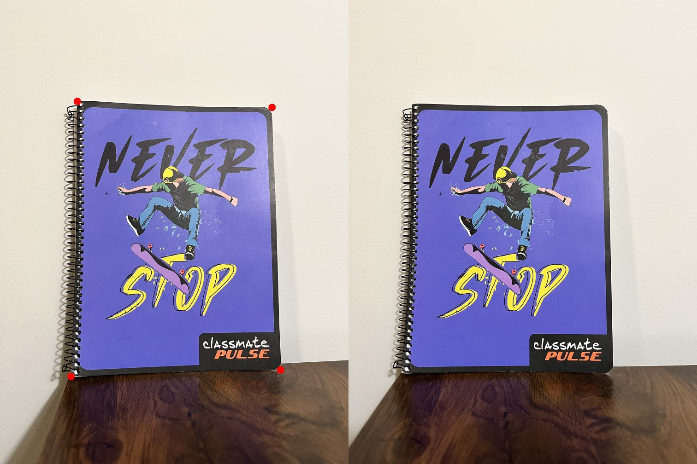
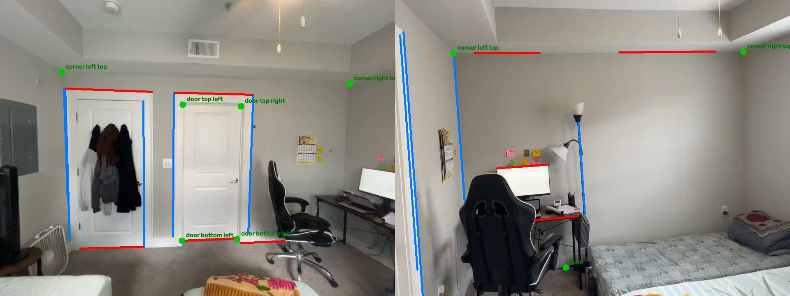

# Module 7: Stereo Vision

Measure objects from two photos with calibrated stereo, and measure a room from
video.

## Overview

| Part | What it does |
|---|---|
| Problem 1 | Finds the distance Z to every point of an object from a stereo pair, then its size: width and height for a rectangle, diameter for a circle, every edge for any other shape |
| Problem 2 | Derivation of the same procedure for uncalibrated stereo (handwritten, in the PDF report) |
| Problem 3 | Finds the length, width and height of a room from video |

## Problem 1: Object size with calibrated stereo

### Setup

One iPhone, calibrated with a chessboard in Module 2, is placed on a table and
slid sideways by a known baseline B = 5 cm between the two photos. Three objects
cover the three shape types:

| Object | Shape | Measured with a ruler |
|---|---|---|
| Notebook | Rectangle | 18.5 x 23.5 cm |
| Cream tube (front outline) | Polygon, 4 edges | top 6 cm, sides 17 cm, bottom 3.2 cm |
| Lid | Circle | 13.5 cm diameter |

### Approach (`stereo.py`)

1. **Intrinsics:** K and the distortion coefficients are loaded from the
   Module 2 calibration and scaled to the photo resolution.
2. **Relative pose:** SIFT features are matched between the two photos (Lowe's
   ratio test), the essential matrix is estimated with RANSAC, and
   `recoverPose` gives the rotation R and translation direction t. t is scaled
   to the baseline B, so the stereo pair is fully calibrated and any small
   rotation of the phone is accounted for.
3. **Correspondence:** the user clicks the object in the left photo. Each
   point's match in the right photo is found automatically by sliding a patch
   along its epipolar line l' = F x and taking the best normalised
   cross-correlation score.
4. **Triangulation:** each matched pair is triangulated into a 3D point
   (X, Y, Z) in millimetres. Z is the distance from the camera; in the
   rectified case this reduces to Z = f B / d.
5. **Size:** lengths are 3D distances between the triangulated points. For a
   rectangle, width and height are the averages of opposite edges; for a
   circle, the diameter is the average of the horizontal and vertical
   diameters; for a polygon, every edge is reported.

### Results

| Object | Measurement | Stereo | Ruler |
|---|---|---|---|
| Notebook | Width | 21.6 cm | 18.5 cm |
| Notebook | Height | 28.8 cm | 23.5 cm |
| Tube | Top | 4.6 cm | 6.0 cm |
| Tube | Sides | 12.9 cm | 17.0 cm |
| Tube | Bottom | 2.2 cm | 3.2 cm |
| Lid | Diameter | 22.0 cm | 13.5 cm |

Distance to the objects (Z) from stereo: 34 to 40 cm for the notebook.



### Matrix checks

For every pair the code also builds F, E and R and checks the properties they
must satisfy. All three pairs pass every check.

| Check | Expected | Notebook | Tube | Lid |
|---|---|---|---|---|
| rank(F) | 2 | 2 | 2 | 2 |
| Singular values of E | (s, s, 0) | (1, 1, ~0) | (1, 1, ~0) | (1, 1, ~0) |
| det(R) | +1 | 1.000000 | 1.000000 | 1.000000 |
| \|R R^T - I\| | 0 | 2.4e-15 | 4.6e-16 | 5.2e-16 |
| Rotation between views | small | 4.73° | 3.71° | 1.54° |

Notebook pair (F scaled so its last entry is 1):

```
F = [  1.70e-08   5.09e-07  -8.30e-04 ]
    [  8.63e-07  -2.14e-08  -2.58e-02 ]
    [ -5.58e-04   2.48e-02   1.00e+00 ]

E = [ -0.0010  -0.0306   0.0122 ]        R = [  0.9966  -0.0003   0.0824 ]
    [ -0.0519   0.0013   0.9986 ]            [  0.0004   1.0000  -0.0013 ]
    [ -0.0126  -0.9995   0.0003 ]            [ -0.0824   0.0013   0.9966 ]

t = (-49.97, 0.61, 1.53) mm
```

## Problem 3: Room dimensions from video (`room.py`)

### Approach

1. **Focal length from video:** when the camera rotates, two frames are related
   by the homography H = K R K^-1. The focal length is found by searching for
   the f that makes K^-1 H K closest to a true rotation (R R^T = I) over all
   frame pairs of `turning_video.mp4`. This calibrates the video mode of the
   camera directly from the footage.
2. **Vanishing points:** on a frame of each wall, lines that are vertical on
   the wall (door edges, room corners) and lines that are horizontal on the
   wall (door tops, floor line, top of the wall) are marked. Each set meets at a
   vanishing point v, found by least squares (SVD). With K, each vanishing point
   gives a 3D direction d = K^-1 v, and the wall normal is n = d_h x d_v.
3. **Metric wall plane:** every marked pixel is back-projected onto the plane
   n, X = 1, which gives the wall's geometry up to a single scale.
4. **Scale:** the door height (standard US interior door, 80 in = 2032 mm) fixes
   the scale on the door wall, giving the room height and the door wall's width.
   The room height then scales the perpendicular desk wall.

### Results

| Measurement | Value |
|---|---|
| Room height (floor to top of wall) | **2.42 m** |
| Door wall width | **4.21 m** |
| Desk wall width | **3.44 m** |
| Focal length from video | 790 px (at 960 px wide) |

Consistency checks:

- The vertical and horizontal directions on each wall come out 89.5° and 89.7°
  apart, matching the expected 90°.
- The door comes out 85 cm wide, within the standard 76 to 91 cm for US
  interior doors.
- 2.42 m matches a standard 8 ft (2.44 m) ceiling.



## Project structure

```
module7/
├── __init__.py               web app page (Problem 1 and Problem 3 tabs)
├── stereo.py                 Problem 1: pose, epipolar matching, triangulation, sizes, matrix checks
├── measure_stereo.py         CLI: runs Problem 1 on all three objects
├── room.py                   Problem 3: focal length, vanishing points, room size (also a CLI)
├── calibration/
│   └── camera_params.npz     K and distortion from Module 2
├── data/
│   ├── photos/               stereo pairs + examples.json (ruler sizes, saved clicks)
│   └── room/                 the room videos + room.json (marked lines and points)
└── results/
    ├── notebook_pair.jpg
    └── room_walls.jpg
```

## Usage

Web app (from the repo root):

```
pip install -r requirements.txt
streamlit run app.py
```

Open Module 7. In Problem 1, pick an object and the saved points are already
placed; you can clear them and click your own, or upload your own stereo pair.

Command line (from `modules/module7`):

```
python measure_stereo.py                 # Problem 1, all three objects
python measure_stereo.py --baseline 50   # with a different baseline (mm)
python room.py                           # Problem 3
```

## References

- R. Hartley and A. Zisserman, *Multiple View Geometry in Computer Vision*, 2nd ed., 2004.
- R. Hartley, "In defense of the eight-point algorithm", IEEE TPAMI, 1997.
- D. Nistér, "An efficient solution to the five-point relative pose problem", IEEE TPAMI, 2004.
- A. Criminisi, I. Reid and A. Zisserman, "Single view metrology", IJCV, 2000.
- R. Hartley, "Self-calibration from multiple views with a rotating camera", ECCV, 1994.
- D. G. Lowe, "Distinctive image features from scale-invariant keypoints", IJCV, 2004.
